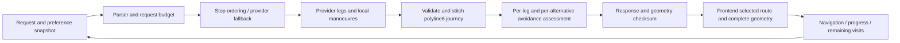

# Phase 5 — routing engine validation

Date: 2026-10-27. **PHASE5_PARTIALLY_VERIFIED. Overall production NO-GO.**

## Baseline and integration

Phase 4 PR #340 was still open at discovery, with frontend/backend/SQL checks successful, mergeable/CLEAN and unchanged head `1ce4b2cb565204341c129957bed53b21f347b756`. Under the user's earlier instruction to commit to main, it was normally squash-merged through GitHub without an administrator bypass, forced push or protection change. Phase 5 branch `codex/phase5-routing-verification` starts at latest main `8010165282c60aaa5ba9e0f8f6518a1356ee5448`; main CI subsequently passed ([run](https://github.com/perpetualadam/Voyagr/actions/runs/40534955596)). No Phase 4 changes were duplicated or overwritten. Working tree was clean before Phase 5.

Targeted baseline: 73 Python tests and 21 Jest tests passed. Source confirmed first-leg-only optimized summary geometry, local manoeuvre indices concatenated without offsets, duplicate recovery/preference parsers selecting first-leg shapes, missing intermediate stops in automatic reroutes, and no shared transport budget. The first new geometry regression run produced 13 failures / 3 passes before wiring the repairs. These were expected baseline failures, not suppressed final failures.

## Architecture map



`multidrop.py` owns optimized `/api/route` and `/api/multi-stop-route` assembly. `route_entries.py` and `valhalla_parsing.py` also construct normal/recovery/preference alternatives. `journey_geometry.py` now supplies common decoding/stitching and geometry consistency checks. `integrity.py` evaluates the actual selected route and all leg evidence; `integrity_api.py` covers public navigation response branches and caches. Browser route-selection preserves journey ranges and assessments. Calculate/GPS/traffic requests share sequence/snapshot/cancellation ownership through `avoidance-integrity.js`; lifecycle/map gates remain enforced. Legacy `routing_engines.py` and `satnav.py` remain distinct desktop paths, not proven covered by the HTTP lifecycle.

## Installed-engine evidence

**REAL_ENGINE_EXECUTION_NOT_TESTED.** Raw loopback discovery: [VOYAGR_PHASE5_ENGINE_DISCOVERY.json](VOYAGR_PHASE5_ENGINE_DISCOVERY.json).

- Docker CLI exists, but `docker ps` reported no running containers. No local listeners on Valhalla 8002, GraphHopper 8989 or OSRM 5001. Loopback metadata probes failed; no routing request was executed against a graph.
- No `valhalla_service`, `graphhopper` or `osrm-routed` binary was found, and repository discovery found no usable OSM PBF/OSRM routing graph. Provider URL variables were not injected; repository defaults were inspected. No remote configured/production endpoint or public/paid routing API was probed.
- `valhalla.json` declares `./tiles`, auto/pedestrian/bicycle costing and service limits; it does not prove those tiles or a compatible engine exist. `setup_valhalla.sh` and `deploy/setup-valhalla-contabo.sh` reference mutable `latest` images, with different image namespaces. These are deployment instructions, not an installed version/build/data manifest.
- Consequently installed version, build, graph date, encoded values and profile-specific restrictions are UNKNOWN for every provider. No production VPS access was attempted. Kivy is unavailable; desktop execution remains untested.

## Capability matrix

| Provider | Source integration requests | Alternatives / vehicle modes | Native enforcement evidence | Phase 5 result |
|---|---|---|---|---|
| Valhalla | Snapped exclusion points, costing preferences; no directly verified excluded-way IDs or exclusion polygons | Alternatives; auto/pedestrian/bicycle requested, installation-dependent restrictions | No installed build/graph/profile evidence; accepted options are insufficient | UNVERIFIED; real execution not tested |
| GraphHopper | Custom-model areas/priorities, encoded road properties, flexible routing/CH settings | Alternatives/preference options; configured profiles need installation checks | No actual encoded-value/profile manifest or graph-backed geometry comparison | UNVERIFIED; real execution not tested |
| OSRM | Configured fallback lacks native camera/zone polygons or custom penalties; driving only unless separately declared profiles | Alternatives where existing integration requests them; no assumption URL labels change the graph | Public service not accessed; local 5001 unavailable | Native avoidance unsupported; real execution not tested |
| Haversine | Stop-order/time estimate only | No road graph or navigation geometry | Cannot establish legal route or avoidance | Missing road geometry yields INCOMPLETE_ROUTE |
| Legacy desktop/custom references | Separate basic provider/direct Kivy paths | Runtime/graph-dependent | No desktop execution or parity proof | NOT_VERIFIED |

Common avoidance validation remains independent of provider names/options. No native hard-enforcement capability is newly advertised. Mandatory unknown/unsupported/conflicting routes stay excluded from automatic navigation; manual acceptance never rewrites a result as satisfied.

## Reproducible operator replay

Run from repository root:

```
.venv/bin/python scripts/replay-routing-engines.py --manifest scripts/fixtures/routing-engine-replay.json
```

The default manifest lists 12 required scenarios for each provider: normal, point exclusion, polygon exclusion, road exclusion, camera, railway crossing, toll, alternatives, multiple waypoints, unsupported restriction, no compliant route and timeout/failure. All **36 engine/scenario combinations are NOT_TESTED** in this environment, not passing mock substitutes.

Before graph replay, an operator must fill graph-derived request bodies/paths, record installed version/build/graph/profile and authoritative road/restriction evidence, add forbidden polygon or no-route oracles, then explicitly mark `graph_fixture_verified`. The provided request example is a schema example, not invented road ground truth. Empty scenario fixtures remain blocked. Use an isolated local fault proxy for timeout cases. The tool permits only credential-free loopback URLs and does not follow redirects. It checks complete route geometry against polygon interiors **and segment/boundary intersections**, not just vertices. Tests demonstrate an excluded area crossing between distant vertices is detected. A 200 without an enforcement oracle remains GEOMETRY_VALID_ENFORCEMENT_UNVERIFIED. A successful fixture geometry check is scoped to that fixture, not universal enforcement or proof of road IDs/vehicle legality.

No production service/configuration/data was changed. Next acceptance step is to provision reviewed isolated graphs and fill/run these fixtures, then review actual geometry, edge/vehicle restrictions and no-route behavior. This is required before an engine-verification claim.
