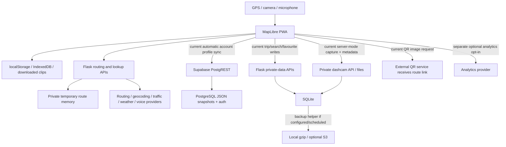

# Local-first storage and optional cloud sync — Phase 1 audit

Date: 2026-11-14. Audited repository baseline: `c902cb1d33c7f62a661bfd6068af8080057e4106`
(main, PR #493). Branch: `docs/local-storage-sync-audit`.

**Phase 1 only.** Application code, schemas, tests, configuration and production
records are not modified by this delivery. The companion
[implementation plan](local-first-sync-implementation-plan.md) is a proposal, not an
implemented privacy control. Production readiness for the requested complete
architecture remains **NO-GO**. This does not mean the current app must be shut down.

## Scope and evidence boundaries

This audit revisits the frontend, web API, database definitions, local persistence,
service worker, provider boundaries, logging and backup helpers. It builds on the
[location inventory](location-data-inventory.md), [threat model](location-threat-model.md)
and [retention assessment](location-retention-policy.md), rather than treating their
pre-#493 baseline as the current cache implementation.

The user reported that VPS1 deleted 62 legacy route-cache rows, returned a count of
zero, and that Voyagr was active afterwards. That is operator-provided evidence;
no new VPS connection or independent production database inspection was performed.
It does not prove that backup copies were erased. This phase does not delete any
records or assume other stores are empty.

No `.env` secret values, real account records, recordings, personal route exports,
production PostgreSQL/SQLite databases or provider accounts were inspected. Applied
RLS, actual server encryption, logs, backups and provider retention remain unverified
where only repository templates are available.

## Verified technology

| Component | Repository evidence | Conclusion |
|---|---|---|
| Map UI / PWA | `static/js/voyagr-core.js:306`, `templates/index.html`, `service-worker.js` | MapLibre PWA is active; reuse it |
| Web backend | `voyagr_web.py:91`; `voyagr/api/*` | **Flask**, not FastAPI. No active FastAPI entry point/import was found in the inspected web/dependency sources |
| App database | `voyagr/config/settings.py:36`; `voyagr/models/database.py` | **SQLite** `voyagr_web.db` for trips, favourites, history, settings, telemetry and dashcam metadata |
| Accounts / profile cloud | `static/js/app/supabase-auth-orchestration.js:499`; `supabase-selfhost/docker-compose.yml`; `volumes/db/init/01-voyagr-schema.sql` | Supabase auth/PostgREST/PostgreSQL are separately supported. Actual deployed grants/SQL application not verified |
| Routing | `voyagr/config/settings.py:21–24`; `voyagr/services/routing/engines.py`, `multidrop.py`; `voyagr_web.py` | Valhalla/GraphHopper configured; OSRM optional/fallback, public HTTP default in source. Provider activation/URLs are runtime facts |
| New route cache | `voyagr/services/routing/private_route_cache.py`; `voyagr_web.py:726` | Private process memory, 840-second serving expiry, idle sweep <=60s under normal scheduling, bounded bytes/count. Retired disk cache helpers perform no SQL |
| Redis | `voyagr/utils/rate_limiting.py`; `voyagr/config/rate_limit_storage.py` | Rate-limit counters, not the current route-body cache |
| Cloud sync | `static/js/app/profile-store-orchestration.js:81–185`; `trip-history-orchestration.js:73`; `search-favorites-orchestration.js` | Existing direct Supabase snapshot sync plus Flask history/favourite APIs; no category-consent authority found |

## Necessary processing versus optional retention

Continuous position updates used for map following, speed, route progress and
rerouting are navigation processing. Routing/lookup services still need precise
coordinates, waypoints, bounded map areas or route geometry when those functions
are requested. Turning cloud backup off must not block these requests, require an
account, round locations away or introduce additional navigation-start checks.

An active journey recovery record is distinct from a completed history archive.
It contains the current route/progress needed for offline recovery. Recording a
completed history entry, retaining a GPS trace, synchronising a saved route, sending
feedback, sharing a route and uploading dashcam media are separate purposes.

### Data-flow overview

Arrows show supported code paths, not verified production traffic. Cloud-snapshot
writes **bypass Flask**, so a Flask-only consent check cannot secure every upload.

## Current storage, transmission and management inventory

Frontend `app/` and `modules/` source paths below are relative to `static/js/`;
backend `api/`, `services/` and `utils/` paths are relative to `voyagr/`. Other
paths are relative to the repository root. Line references describe the audited
commit, not unknown production revisions.

Potentially personal data includes precise locations and route geometry even
without a name; repeated home/work positions, times and network identifiers can
identify someone. Public road/camera/charging feature datasets are different from
records of who queried those places and when.

| Path / purpose | Current data flow and storage | Default / access / retention / deletion | Source evidence |
|---|---|---|---|
| Live GPS and route progress — necessary | Browser geolocation returns precise fix, accuracy, speed, heading and time. UI/matching/progress use current state; some fixes trigger necessary lookups/reroutes | No ordinary continuous server GPS-track table identified. Do not confuse transient smoothing/current fixes with an opted-in journey trace | `app/gps-orchestration.js:811,918,1744`; `app/auto-gps-orchestration.js:78` |
| Active journey recovery — necessary local functionality | IndexedDB `voyagr-nav` v2 stores `active_route` and `speed_limits`; current route has polyline, instructions, progress hint, destination and continuation | Durable record schema v3, ownership protocol v1, guarded replace/clear. Four-hour resume freshness check is not a blanket physical-retention deadline. Local ownership is a concurrency guard, not account authentication | `modules/navigation/offline-navigation.js:14–18,94–118,300`; `app/offline-navigation-orchestration.js:149` |
| Route requests / multi-stop / traffic — necessary | Flask/provider requests include exact origin/destination/via points/stops, route bounds, avoidance and time inputs | Current route cache is browser-capability scoped; no account ID needed. Reroute/force-refresh bypass cache reads/writes. Worker restart/miss causes fresh routing. Does not grant cloud-storage consent | `services/routing/private_route_cache.py`; `request_params.py`; `multidrop.py`; `voyagr_web.py` |
| Geocoding, road/speed/lane/POI/traffic/weather — necessary when requested | Query text, fix or bounds reach app and relevant configured Nominatim/postcodes.io/Overpass/TomTom/OpenWeatherMap services; map tile paths can reveal viewport | App/process/public-map caches and external logs exist separately from personal backup. Provider retention, contracts and transfers not verified | `api/search.py`; `api/navigation.py`; `api/traffic.py`; `overpass_helper.py`; `speed_limit_detector.py` |
| Saved routes — optional explicit save | `savedRoutes` in localStorage, copied into profile snapshots with labels/geometry/costs | Local save/delete exists. Account snapshot can auto-upload the entire saved-route collection; no separate cloud category grant. No general age-based local purge | `app/route-saving-orchestration.js:38,105`; `app/profile-store-orchestration.js:43–46` |
| Recent destinations/search history — optional retention | Local `voyagrRecentDestinations` (15) plus authenticated server search-history POSTs containing query/name/coordinates | Local recents have no-network helper, but `addToSearchHistory` also sends to server if a token exists. Server history trimmed to 50/account; owner clear-all endpoint exists | `modules/navigation/recent-destinations.js:8,64`; `app/search-favorites-orchestration.js:20`; `api/search.py:930–980` |
| Favourites — optional save | Current favourites grid/save/edit/delete primarily uses authenticated Flask `/api/favorites` and SQLite | Own-user filtering exists, but there is no category consent gate or equivalent durable guest/offline favourites repository on the inspected path. Cannot simply switch its upload off and assume local functionality survives | `app/search-favorites-orchestration.js:73,119,143,170`; `api/search.py:991` |
| Completed journey history — optional recording | Qualifying navigation completion invokes `persistCompletedTrip`; writes localStorage `voyagrLocalTrips`, then POSTs precise endpoints/labels/time/cost to server when signed in | No explicit history-recording opt-in found. Local list capped at 50 but **not account-namespaced**; server GET is owner-filtered/latest 50, not an expiry policy. Owner per-trip delete exists | `app/navigation-lifecycle-orchestration.js:399`; `app/trip-history-orchestration.js:11,73,138,199`; `api/trips.py:22,97,113` |
| Optional GPS journey traces — proposed, not evidenced as a complete product feature | No separate user-enabled durable trace repository/control was established. Active recovery stores a current progress hint; server-mode dashcam separately stores repeated fixes | Do not enable trace collection merely because an IndexedDB store is added. Proposed trace switch must be separately OFF | `app/offline-navigation-orchestration.js:149`; `modules/navigation/offline-navigation.js:94`; `templates/index.html:2556` |
| Per-profile preferences — optional backup | Many localStorage keys plus `voyagr_all_settings`; guest/account snapshots in `voyagr_profiles_v1`; account profile auto-upserts PostgreSQL JSON | Preferences already have import/export/reset. Snapshots include saved routes; no per-category/policy-version consent. Login schedules pull/sync; local guest-import prompt is not server-enforced cloud permission | `app/settings-orchestration.js:392`; `app/profile-store-orchestration.js:9–13,81,94,194,210`; `app/supabase-auth-orchestration.js:454` |
| Global settings API — integrity/optional-storage concern | Theme, units, gestures, battery and other frontend actions also POST `/api/app-settings`; SQLite updates shared settings rows without owner scoping | This path has no private-user/category gate; it must be separated into operator defaults versus personal settings. Blocking the endpoint wholesale could break existing local settings behaviour | `api/settings.py:32,66–81`; `app/map-theme-orchestration.js:92`; `app/battery-saving-orchestration.js:36`; `app/gesture-control-orchestration.js:52`; `modules/navigation/units.js:308` |
| Account authentication — necessary only for account features | Supabase email/OAuth identity, UUID, access/refresh sessions; SDK configured `persistSession:true` | Sign-in is not a history/backup permission. Trip/search/favourite APIs use JWT owner filtering with optional loopback development bypass. Dashcam uses stricter current-session verification | `app/supabase-auth-orchestration.js:499,524,670,680`; `utils/auth.py:58`; `utils/dashcam_auth.py` |
| Direct profile cloud records — optional storage | Browser upserts/selects `public.voyagr_profile_snapshots` through PostgREST; plaintext JSON at application layer | Supplied SQL has own-user RLS for CRUD but **no category, consent version, grant state or withdrawal epoch**. Snapshot delete policy exists, but no complete user-facing cloud-delete/account-erasure orchestration found | `app/profile-store-orchestration.js:94–185`; `supabase-selfhost/volumes/db/init/01-voyagr-schema.sql` |
| Dashcam device-only — optional capture | MediaRecorder collects 1s chunks into an in-memory array, creates Blob on stop, then triggers device download | Device-only option exists but checkbox is initially unchecked. Not an IndexedDB/OPFS clip library; crash before successful download can lose recording. Download's OS backup/sync is outside app control | `templates/index.html:1467,2186,2323,2356,2430`; `modules/navigation/dashcam-capture.js` |
| Dashcam server mode — optional backup/track | Authenticated start/stop, video upload, and GPS/speed/heading sender every 5s. SQLite metadata plus owner-directory video and JSON sidecar | Server-mode stop automatically uploads when a blob exists. No separate server-recognised cloud/GPS permission; strict JWT/live session/owner/path controls already exist. Default cleanup setting 7 days, callable cleanup but no automatic scheduler found | `templates/index.html:2375,2490,2556`; `dashcam_blueprint.py:22,94,160,197`; `dashcam_service.py:64,186,207,251,281,296` |
| Route sharing / QR / exports — optional disclosure | Share payload includes labels and, by default, geometry; base64 in URL query is reversible. QR is rendered through external `api.qrserver.com` with full share link in `data=`. WhatsApp/email/clipboard are separate explicit actions | Sharing is not encrypted backup. Link/QR can expose the route to recipient, QR service, URL logs/history/referrers. Settings JSON export is not a comprehensive encrypted personal-data backup | `modules/navigation/route-sharing.js:34–73,271,858`; `app/route-sharing-orchestration.js:184`; `app/settings-orchestration.js:392` |
| Analytics — optional | Google tag loaded only if configured and local `voyagrAnalyticsConsentV1=granted`; explicit page event strips query/hash/referrer | Already OFF for missing choice; withdrawal clears accessible cookies/disables collection. This consent is not a cloud/history/diagnostic grant and is not a server receipt | `app/analytics-consent.js:4–8,25–57`; `templates/privacy_policy.html` |
| Feedback/community/spatial ML — optional contributions/profiling | Explicit speed feedback stores exact fix; community reports store point/time/free text and possible supplied user ID. Spatial ML tables also exist | Display/report expiry is not necessarily physical deletion. Global ML prediction GET/POST and cache diagnostics are now admin-protected. These data classes need separate purpose, permission and retention review | `api/navigation.py:403`; `api/hazards.py:220`; `api/settings.py:108`; `models/database.py:422,483,531,549` |
| Voice — necessary for requested voice commands, optional provider processing | Browser vendor recognition or configured AI transcription receives audio; command text/current fix sent to command API, then may create route/report | Main transcript/TTS log content removed previously; no recording-file retention found in transcription function. Provider retention unknown; do not make cloud-backup opt-in control necessary speech processing | `api/navigation.py:788,823`; `services/voice_transcription.py`; `app/voice-control-orchestration.js:330` |
| Browser SW/tiles/offline caches — necessary or convenience | Explicit private APIs/authenticated GETs bypass caching; dashcam and road evidence network-only. Other GETs can use dynamic CacheStorage; tiles cached by count | Generic API POST failure returns `queued:true`/202 but does **not** persist an outbox in that branch. No demonstrated privacy-aware cloud retry queue. Existing release-coherence/upgrade safeguards must survive migrations | `service-worker.js:15,219–289`; `app/service-worker-orchestration.js`; `app/offline-navigation-orchestration.js` |
| Logs/diagnostics/proxies — mixed | Minimal route/speed/voice logging improved, but residual lookup exception strings can contain request URLs. GET coordinates, base64 share query, IP and tile paths can reach proxy/provider logs | No universal precise-location redactor, optional diagnostic-upload control or verified server log retention. No Sentry/OpenTelemetry integration identified in inspected app/dependency sources. Live proxy/CDN instrumentation unknown | `voyagr_web.py:234`; `api/search.py:450,735`; `api/navigation.py:542`; `production_monitoring.py:74`; `deploy/nginx-vibevoyager.org.conf` |
| Backups/restoration — disaster recovery | Helper copies/gzips SQLite, optional S3 SSE; local private media and PostgreSQL need separate backups. Host/browser/cloud copies unverified | Prior local synthetic experiments showed cleanup filename failure and deleted-row resurrection on restore. No deletion/withdrawal replay ledger. `bool('false')` can enable the S3 branch. Scheduler wiring to web entry point not found | `backup_automation.py:24,38,77,143,162,199`; prior `location-verification-report.md` |

## Priority findings

1. **High — no server-recognised category consent.** Authentication/RLS ownership
   is not cloud/history/dashcam permission. Current direct PostgREST uploads can
   bypass any future Flask-only permission check. Missing consent must deny new
   optional writes without blocking core routing.
2. **High — reproducible cross-profile completion race.** A profile upsert captures
   account A's snapshot, awaits a network result, then writes using mutable
   `activeProfileId`. Switching to B while awaiting can save A's snapshot into B's
   local profile. A later sync can compound the error. Pull has an active-profile
   render check, but also writes a previously captured store after awaiting.
3. **High — local history is shared across account namespaces.** `voyagrLocalTrips`
   has no owner discriminator and is merged with the current server account's
   history. Profile separation for saved routes does not isolate all local data.
4. **High — automatic optional persistence.** Completed history recording and
   account upload, profile snapshots, search history and several preferences are
   not controlled by the requested independent choices. Cloud OFF must cover all
   these paths, not only one new toggle.
5. **High — dashcam is not durable local-first by default.** Device mode exists,
   but is not selected by default; media buffers in RAM, server-mode GPS streams
   before clip upload, and stopping can trigger upload without separate permission.
6. **High — QR generation shares a route with another service.** The actual URL
   builders include the full share link. Base64 is encoding, not encryption.
7. **High — erasure/revocation is not restoration-safe.** Per-record deletes exist,
   but no complete cloud deletion/account-removal/backup restoration protocol or
   server consent authority was established. Historic backup limitations persist.
8. **Medium–High — global settings write path.** A shared SQLite settings row and
   unscoped POST mean personal preferences are not fully local/account-private.
   Treat this as a configuration integrity issue as well as a privacy inventory gap.
9. **Medium–High — residual diagnostics/proxy/storage risks.** Application-level
   plaintext writes, optional lookup exception contents, default public HTTP OSRM,
   and actual VPS/provider storage controls require review. HTTPS is not at-rest
   encryption; no existing E2EE backup protocol was found.
10. **Medium — incomplete storage lifecycle.** IndexedDB recovery and persistence
    requests exist, but no unified structured local store, chunked media library,
    category export/clear controls, proven resumable outbox or loss-recovery UI.

These are implementation findings or local synthetic observations, not evidence
that a real user's account has been exposed or that production is actively using
every supported provider/upload path.

## Encryption, eviction, export and deletion assessment

- LocalStorage and IndexedDB hold app-readable structured data. No app-level
  encryption/key-vault protocol was found for the listed records. Browser/OS disk
  encryption is not established from source. HTTPS protects transport, not files.
- Plain JSON snapshots and recording bytes are written at the application layer.
  Existing private filesystem permissions, owner paths and session checks are
  valuable access controls, but are not encrypted storage. Host/Postgres volume
  encryption and key management remain unverified; backup S3 SSE does not establish
  live PostgreSQL or dashcam encryption.
- `navigator.storage.persist()` and storage estimation are already requested by PWA
  helpers. A request may be denied, and site clear/private mode/device loss can
  still destroy local data. Persistence is not a backup, quota guarantee or crypto.
- Settings JSON export/import/reset, saved-route delete, individual history/favourite
  delete and clip download exist. They do not amount to a complete owner-scoped,
  validated export/restore/delete system covering all personal data. Reset must not
  be reused as an unreviewed `localStorage.clear()` that also loses credentials,
  consent state or active journey state.
- Encrypting with a key stored beside data does not protect against compromised
  same-origin scripts. Non-extractable WebCrypto keys can still be used by an XSS
  adversary. Passphrase/recovery-key design must not lock core navigation or ask
  for key entry while driving. Lost keys cannot be reconstructed by the operator
  in a genuine E2EE design without an explicitly chosen recovery mechanism.
- User-exported clips, QR links, shared email/social messages, OS/browser backups,
  provider logs and backup replicas cannot be recalled by deleting a local row.

## Phase 1 observations and verification

No regression tests or application code were added/edited. Existing web/JS/SQL
suites are run only as a baseline; they do not prove the requested new controls.
Detailed results are recorded in the companion plan's Phase 1 delivery section.

Two read-only synthetic experiments used the actual frontend modules:

- **Profile race:** a Map-backed fake localStorage, captured timer callback and
  deferred fake Supabase `.upsert().select().single()` response. Start A's sync,
  switch to B, resolve A's response; A's sentinel route appears in B's local profile.
  Result: reproduced. No real browser storage, network or user data was touched.
  Initially attempting the module's private non-exported sync method was invalid;
  reproduction correctly used the exported scheduler and its timer callback.
- **QR data flow:** actual share-payload/base64/link/QR builders with synthetic
  labels/geometry; decode the QR URL's `data` parameter and its `route` payload.
  Destination and geometry were present for `api.qrserver.com`. No HTTP request
  was sent. This proves the constructed disclosure, not the provider's retention.

Not verified: physical Android/browser storage eviction, real camera backgrounding,
media durability, live provider behaviour, current users, actual SQL RLS grants,
TLS/storage encryption, infrastructure logging/replicas, applied consent policies
(none supplied), cloud queue revocation or end-to-end encrypted recovery.

## Phase 1 outcome

The current app already has useful building blocks and a private temporary route
cache. Reuse them. The requested complete local-first/optional-cloud architecture
is **not yet implemented**, and producing these documents does not enable it.
Proceed only through the gated, separately tested steps in the implementation plan.
